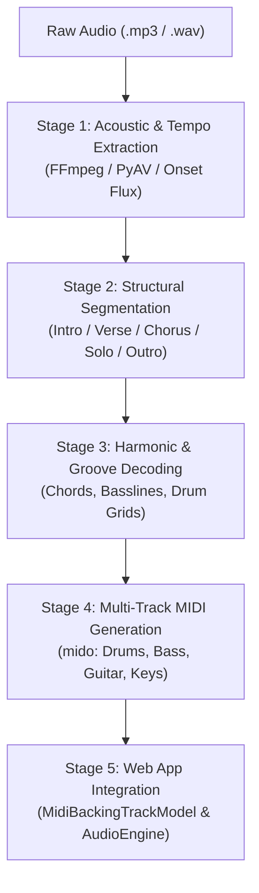
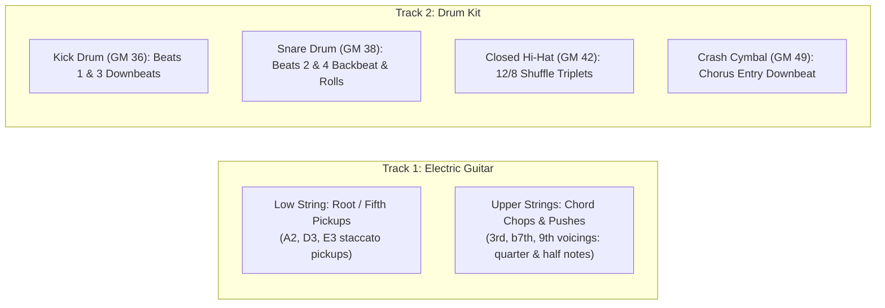

# 🎼 Backing Track Transcriber & Audio-to-MIDI Synthesis Skill

This skill provides an end-to-end standard methodology to analyze audio backing tracks (`.mp3`, `.wav`), interpret their musical structure (Intro, Verse, Chorus, Solo, Bridge, Turnaround, Outro), transcribe their rhythmic and harmonic content, and generate authentic multi-track General MIDI files for web applications, DAWs, and fretboard visualization engines.

---

## 1. Five-Stage Transcription Pipeline

---

## 2. Stage 1: Acoustic & Tempo Extraction

1. **Audio Ingestion**:
   - Resample audio to mono 22,050 Hz or 44,100 Hz using `av.AudioResampler`.
   - Compute short-time energy (RMS) across 10ms hops:
     $$E(t) = \sum_{n=0}^{N-1} x^2(t \cdot H + n)$$
2. **Onset Detection & Autocorrelation**:
   - Extract spectral/transient flux: $\Delta E(t) = \max(0, E(t) - E(t-1))$.
   - Run autocorrelation across the lag window corresponding to 45–200 BPM:
     $$R(\tau) = \sum_{t} \Delta E(t) \cdot \Delta E(t+\tau)$$
   - Check octave harmonics ($\tau / 2, 2\tau, \frac{3}{2}\tau$) to resolve tempo ambiguities (e.g., 65 BPM vs 130 BPM).
3. **Meter Identification**:
   - 4/4 (standard common time), 6/8 or 12/8 (slow blues / rock ballad triplet compound meter), 3/4 (waltz), 2/2 (bossa nova cut time).

---

## 3. Stage 2: Structural Segmentation (Song Form)

Backing tracks generally follow recognizable structural architectures:

| Form Architecture | Standard Section Progression | Typical Bar Lengths | Genre Examples |
|---|---|---|---|
| **12-Bar Blues Cycle** | `[Intro 4b]` $\to$ `[Verse 1 12b]` $\to$ `[Verse 2 12b]` $\to$ `[Solo 1 12b]` $\to$ `[Solo 2 12b]` $\to$ `[Turnaround / Outro 4b]` | 12 bars per cycle | Blues A7, Minor Blues in Am |
| **Bebop / Swing Turnaround** | `[Count-in 2b]` $\to$ `[Head / A1 8b]` $\to$ `[A2 8b]` $\to$ `[Bridge B 8b]` $\to$ `[Turnaround / Solo Vamp 8b]` | 8 bars / 32-bar AABA | Jazz 2-5-1 C Major |
| **Bossa Nova Cycle** | `[Intro 4b]` $\to$ `[Part A (2-5-1-6) 8b]` $\to$ `[Part B 8b]` $\to$ `[Solo Vamp 8b]` $\to$ `[Outro 4b]` | 8 or 16 bars | Bossa Nova (2516) C Major |
| **Rock / Pop Ballad** | `[Intro 4b]` $\to$ `[Verse 8b]` $\to$ `[Pre-Chorus 4b]` $\to$ `[Chorus 8b]` $\to$ `[Solo / Jam 16b]` $\to$ `[Outro 4b]` | 4, 8, 16 bars | Rock Pop G Major, Bm Rock Ballad, Am Dark Ballad |
| **Modal Vamp / Fusion** | `[Intro 4b]` $\to$ `[Theme A (Main Riff) 8b]` $\to$ `[Development B 8b]` $\to$ `[Solo Vamp 16b]` $\to$ `[Outro 4b]` | 8 or 16 bars | A Dorian, D Dorian, E Phrygian, E Lydian, A/F# Locrian |

### Section Boundary Detection Rules:
- **Intro**: Bar 1 to entry of full drums/bass (typically 2 to 4 bars).
- **Verse (Section A)**: Main thematic progression, lower energy, steady comping.
- **Chorus (Section B)**: Energy surge (+2 to +4 dB RMS), crash cymbal on bar 1, open hi-hat or ride, layered guitars/keys.
- **Solo Section**: Dynamic rhythm bed, high rhythmic propulsion for soloist improvisation.
- **Turnaround / Outro**: Resolution to tonic, fading energy or ritardando.

---

## 4. Stage 3: Harmonic & Groove Decoding

### Harmonic Archetypes:
1. **Dominant Blues (12-Bar)**:
   - I7 (4 bars) $\to$ IV7 (2 bars) $\to$ I7 (2 bars) $\to$ V7 (1 bar) $\to$ IV7 (1 bar) $\to$ I7 (1 bar) $\to$ V7 (1 bar turnaround).
2. **Minor Blues (12-Bar)**:
   - i7 (4 bars) $\to$ iv7 (2 bars) $\to$ i7 (2 bars) $\to$ $\flat\text{VI}7$ (1 bar) $\to$ V7alt (1 bar) $\to$ i7 (1 bar) $\to$ V7alt (1 bar).
3. **Jazz 2-5-1**:
   - ii7 $\to$ V7 $\to$ Imaj7 $\to$ VI7 (e.g. Dm9 $\to$ G13 $\to$ Cmaj9 $\to$ A7$\sharp$9).
4. **Bossa Nova 2-5-1-6**:
   - Dm9 $\to$ G13 $\to$ Cmaj9 $\to$ A7($\flat$13).
5. **Modal Centers**:
   - **Dorian**: i7 – IV9 (Am7 – D9 or Dm7 – G9).
   - **Phrygian**: i5 – $\flat\text{II}5$ – $\flat\text{III}5$ (E5 – F5 – G5).
   - **Lydian**: $\text{I}\text{maj7}(\sharp11)$ – $\text{II}/\text{I}$ (Emaj7$\sharp$11 – F#/E).
   - **Mixolydian**: $\text{I}$ – $\flat\text{VII}$ – $\text{IV}$ (A – G – D).
   - **Locrian**: $\text{i}^\varnothing$ – $\flat\text{II}\text{maj7}$ (Am7b5 – Bbmaj7).

### Groove & Drum Grids:
- **Swing / Triplet subdivisions**: Ticks per 16th swing: 60/40 or 66/34 ratio.
- **Bossa Clave**: Syncopated strums on steps `[0, 3, 6, 10, 12]`, surdo on beats 1 and 3.
- **Metal Chugs**: 16th-note galloping palm mutes with power chord punches.
- **Walking Bass**: 4 quarter notes per measure outlining chord root, third, fifth, and chromatic approach.

---

## 4.1. Rhythmic Quantization & Note Articulation Protocol
*(Derived from Songscription AI Reverse-Engineering & Ground-Truth Musical Sheet Analysis)*

When transcribing or synthesizing authentic musical accompaniment, **note durations and breathing rests** define the groove feel just as much as pitch selection:

1. **Quarter Notes ($1.0$ beat, $480$ ticks @ 480 PPQ)**:
   - Provide harmonic grounding and rhythmic weight.
   - Crucial for syncopated pushes: e.g. the 3rd triplet of Beat 2 (Beat 2-uh) or Beat 4 (Beat 4-uh) hit that sustains for a full quarter note into the following beat.
   - Used for primary comping downbeats when establishing harmonic stability.

2. **Half Notes ($2.0$ beats, $960$ ticks @ 480 PPQ)**:
   - Used for spacious ballad chords, modal vamp holds, and cadence arrival points.
   - Crucial for **turnaround bars** (e.g. Bar 12 of a 12-bar blues: Beat 1 V7 push held for 2 beats, Beat 3 V7#9 push held for 2 beats).

3. **Eighth Notes & Triplet Staccato Chops ($0.33$ to $0.5$ beat, $160$ to $240$ ticks)**:
   - Percussive "chops" and fret-hand damping: downbeat chops on Beat 1 and Beat 2, providing percussive snap without cluttering the sustain window.
   - Root pickups on the 3rd triplet of beats (low-string bass approach notes before upper-register chord voicings).

4. **Deliberate Rests (Negative Space)**:
   - Rests on the middle triplet of beats allow the kick and snare drums to punch through with high clarity.
   - Silence immediately preceding turnaround rolls or cadence climaxes builds dramatic tension.

---

## 4.2. Two-Instrument Arrangement Paradigm: Electric Guitar & Drum Kit

When producing tight, high-clarity blues, rock, or modal backing tracks, avoid over-saturating the mix with synthetic bass and organ layers. Instead, employ the **Two Distinct Core Instruments** paradigm:

### Key Rules for the Electric Guitar + Drum Kit Duo:
1. **Electric Guitar (Channel 0 / GM 26 Jazz Guitar or GM 27 Clean Electric)**:
   - Plays **hybrid comping**: low strings (strings 6 & 5) provide rhythmic bass motion (walking approaches, pedal roots) while middle/upper strings (strings 4, 3, 2) supply the harmonic character (tritones, guide tones, color extensions).
   - Dynamic articulation: Staccato chops on 1 and 2, **Quarter-Note pushes** on 2-and/2-uh sustaining into 3, and **Dotted Quarter / Half-Note anticipations** on 4-uh sustaining across barlines.
2. **Drum Kit (Channel 9 / Channel 10 GM Drums)**:
   - Anchors the tempo pocket with solid kick on 1 & 3 and crisp snare backbeat on 2 & 4.
   - Hi-hat maintains the swung shuffle subdivision ($12/8$ triplet grid: 3 hits per quarter-note beat).
   - Never overlaps with the guitar frequency spectrum; leaves negative space for guitar chokes and pick attacks.

---

## 5. Stage 4: Multi-Track Standard MIDI Synthesis

Every backing track must be compiled into standard multi-track General MIDI:
- **Track 0: Conductor**: Tempo meta-events, Time Signature, Section Markers (`MetaMessage('marker', text='Verse 1')`).
- **Track 1: Electric Guitar (Channel 0)**: GM 26 Jazz Guitar / GM 27 Clean Guitar / GM 29 Overdriven Guitar (Hybrid comping, staccato chops, quarter notes, half notes).
- **Track 2: Drum Kit (Channel 9 / Channel 10)**: GM Drum Map (35/36 Kick, 38 Snare, 42 Closed HH, 46 Open HH, 49 Crash, 51 Ride).
- *(Optional Auxiliary Tracks for 4-track arrangements: Track 3 Bass, Track 4 Keys/Organ).*

---

## 6. Stage 5: Web Application Audio Engine Integration

1. Register all track presets in `MidiBackingTrackModel.PRESETS` with:
   - `id`, `name`, `category`, `timeSignature`, `defaultBpm`, `sections`, `progression`.
2. Connect section reporting so the UI displays:
   - Current Section badge: e.g. `[Verse 1 / Bar 3]` or `[Chorus]`.
   - Current Chord badge: e.g. `Chord: Am7 (i)`.
   - Recommended Scale/Mode.
3. Expose one-click standard `.mid` file download for each backing track.
