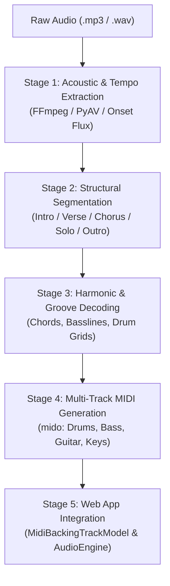

# 🎼 Backing Track Transcriber & Audio-to-MIDI Synthesis Skill

This skill provides an end-to-end standard methodology to analyze audio backing tracks (`.mp3`, `.wav`), interpret their musical structure (Intro, Verse, Chorus, Solo, Bridge, Turnaround, Outro), transcribe their rhythmic and harmonic content, and generate authentic multi-track General MIDI files for web applications, DAWs, and fretboard visualization engines.

---

## 1. Five-Stage Transcription Pipeline

---

## 2. Stage 1: Acoustic & Tempo Extraction

1. **Audio Ingestion**:
   - Resample audio to mono 22,050 Hz or 44,100 Hz using `av.AudioResampler`.
   - Compute short-time energy (RMS) across 10ms hops:
     $$E(t) = \sum_{n=0}^{N-1} x^2(t \cdot H + n)$$
2. **Onset Detection & Autocorrelation**:
   - Extract spectral/transient flux: $\Delta E(t) = \max(0, E(t) - E(t-1))$.
   - Run autocorrelation across the lag window corresponding to 45–200 BPM:
     $$R(\tau) = \sum_{t} \Delta E(t) \cdot \Delta E(t+\tau)$$
   - Check octave harmonics ($\tau / 2, 2\tau, \frac{3}{2}\tau$) to resolve tempo ambiguities (e.g., 65 BPM vs 130 BPM).
3. **Meter Identification**:
   - 4/4 (standard common time), 6/8 or 12/8 (slow blues / rock ballad triplet compound meter), 3/4 (waltz), 2/2 (bossa nova cut time).

---

## 3. Stage 2: Structural Segmentation (Song Form)

Backing tracks generally follow recognizable structural architectures:

| Form Architecture | Standard Section Progression | Typical Bar Lengths | Genre Examples |
|---|---|---|---|
| **12-Bar Blues Cycle** | `[Intro 4b]` $\to$ `[Verse 1 12b]` $\to$ `[Verse 2 12b]` $\to$ `[Solo 1 12b]` $\to$ `[Solo 2 12b]` $\to$ `[Turnaround / Outro 4b]` | 12 bars per cycle | Blues A7, Minor Blues in Am |
| **Bebop / Swing Turnaround** | `[Count-in 2b]` $\to$ `[Head / A1 8b]` $\to$ `[A2 8b]` $\to$ `[Bridge B 8b]` $\to$ `[Turnaround / Solo Vamp 8b]` | 8 bars / 32-bar AABA | Jazz 2-5-1 C Major |
| **Bossa Nova Cycle** | `[Intro 4b]` $\to$ `[Part A (2-5-1-6) 8b]` $\to$ `[Part B 8b]` $\to$ `[Solo Vamp 8b]` $\to$ `[Outro 4b]` | 8 or 16 bars | Bossa Nova (2516) C Major |
| **Rock / Pop Ballad** | `[Intro 4b]` $\to$ `[Verse 8b]` $\to$ `[Pre-Chorus 4b]` $\to$ `[Chorus 8b]` $\to$ `[Solo / Jam 16b]` $\to$ `[Outro 4b]` | 4, 8, 16 bars | Rock Pop G Major, Bm Rock Ballad, Am Dark Ballad |
| **Modal Vamp / Fusion** | `[Intro 4b]` $\to$ `[Theme A (Main Riff) 8b]` $\to$ `[Development B 8b]` $\to$ `[Solo Vamp 16b]` $\to$ `[Outro 4b]` | 8 or 16 bars | A Dorian, D Dorian, E Phrygian, E Lydian, A/F# Locrian |

### Section Boundary Detection Rules:
- **Intro**: Bar 1 to entry of full drums/bass (typically 2 to 4 bars).
- **Verse (Section A)**: Main thematic progression, lower energy, steady comping.
- **Chorus (Section B)**: Energy surge (+2 to +4 dB RMS), crash cymbal on bar 1, open hi-hat or ride, layered guitars/keys.
- **Solo Section**: Dynamic rhythm bed, high rhythmic propulsion for soloist improvisation.
- **Turnaround / Outro**: Resolution to tonic, fading energy or ritardando.

---

## 4. Stage 3: Harmonic & Groove Decoding

### Harmonic Archetypes:
1. **Dominant Blues (12-Bar)**:
   - I7 (4 bars) $\to$ IV7 (2 bars) $\to$ I7 (2 bars) $\to$ V7 (1 bar) $\to$ IV7 (1 bar) $\to$ I7 (1 bar) $\to$ V7 (1 bar turnaround).
2. **Minor Blues (12-Bar)**:
   - i7 (4 bars) $\to$ iv7 (2 bars) $\to$ i7 (2 bars) $\to$ $\flat\text{VI}7$ (1 bar) $\to$ V7alt (1 bar) $\to$ i7 (1 bar) $\to$ V7alt (1 bar).
3. **Jazz 2-5-1**:
   - ii7 $\to$ V7 $\to$ Imaj7 $\to$ VI7 (e.g. Dm9 $\to$ G13 $\to$ Cmaj9 $\to$ A7$\sharp$9).
4. **Bossa Nova 2-5-1-6**:
   - Dm9 $\to$ G13 $\to$ Cmaj9 $\to$ A7($\flat$13).
5. **Modal Centers**:
   - **Dorian**: i7 – IV9 (Am7 – D9 or Dm7 – G9).
   - **Phrygian**: i5 – $\flat\text{II}5$ – $\flat\text{III}5$ (E5 – F5 – G5).
   - **Lydian**: $\text{I}\text{maj7}(\sharp11)$ – $\text{II}/\text{I}$ (Emaj7$\sharp$11 – F#/E).
   - **Mixolydian**: $\text{I}$ – $\flat\text{VII}$ – $\text{IV}$ (A – G – D).
   - **Locrian**: $\text{i}^\varnothing$ – $\flat\text{II}\text{maj7}$ (Am7b5 – Bbmaj7).

### Groove & Drum Grids:
- **Swing / Triplet subdivisions**: Ticks per 16th swing: 60/40 or 66/34 ratio.
- **Bossa Clave**: Syncopated strums on steps `[0, 3, 6, 10, 12]`, surdo on beats 1 and 3.
- **Metal Chugs**: 16th-note galloping palm mutes with power chord punches.
- **Walking Bass**: 4 quarter notes per measure outlining chord root, third, fifth, and chromatic approach.

---

## 5. Stage 4: Multi-Track Standard MIDI Synthesis

Every backing track must be compiled into standard multi-track General MIDI:
- **Track 0: Conductor**: Tempo meta-events, Time Signature, Section Markers (`MetaMessage('marker', text='Verse 1')`).
- **Track 1: Drums (Channel 10)**: GM Drum Map (35/36 Kick, 38 Snare, 37 Rim/SideStick, 42 Closed HH, 46 Open HH, 51 Ride, 49 Crash).
- **Track 2: Bass (Channel 1)**: GM Bass (32 Acoustic, 33 Finger Electric, 34 Pick Electric, 36 Slap, 38 Synth Bass).
- **Track 3: Rhythm Comping (Channel 2)**: GM Guitar (24 Nylon, 25 Steel, 26 Jazz Hollow, 27 Clean Strat, 29 Overdriven, 30 Distortion).
- **Track 4: Harmonic Foundation (Channel 3)**: GM Keys (0 Grand Piano, 4 Rhodes, 17 Percussive Organ, 48 Strings).

---

## 6. Stage 5: Web Application Audio Engine Integration

1. Register all track presets in `MidiBackingTrackModel.PRESETS` with:
   - `id`, `name`, `category`, `timeSignature`, `defaultBpm`, `sections`, `progression`.
2. Connect section reporting so the UI displays:
   - Current Section badge: e.g. `[Verse 1 / Bar 3]` or `[Chorus]`.
   - Current Chord badge: e.g. `Chord: Am7 (i)`.
   - Recommended Scale/Mode.
3. Expose one-click standard `.mid` file download for each backing track.
