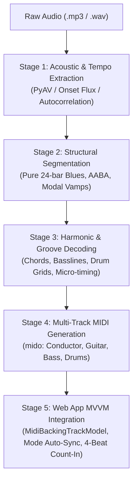
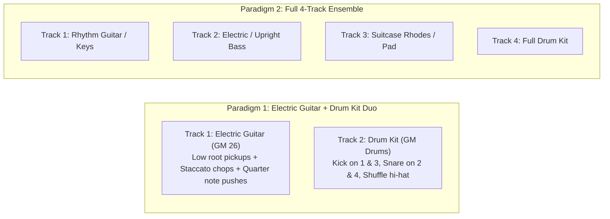

# 🎼 Backing Track Transcriber & Audio-to-MIDI Synthesis Skill

This skill provides an end-to-end standard methodology to analyze audio backing tracks (`.mp3`, `.wav`), interpret their musical structure (Intro, Verse, Chorus, Solo, Turnaround, Outro), transcribe their rhythmic and harmonic content, and generate authentic multi-track General MIDI files for the **Guitar Fretboard Visualization** web application.

---

## 1. Five-Stage Transcription Pipeline

---

## 2. Stage 1: Acoustic & Tempo Extraction

1. **Audio Ingestion**:
   - Resample audio to mono 22,050 Hz using `av.AudioResampler`.
   - Compute short-time energy (RMS) across 10ms hops:
     $$E(t) = \sqrt{\frac{1}{N} \sum_{n=0}^{N-1} x^2(t \cdot H + n)}$$
2. **Onset Detection & Autocorrelation**:
   - Extract spectral/transient flux: $\Delta E(t) = \max(0, E(t) - E(t-1))$.
   - Run autocorrelation across the lag window corresponding to 45–220 BPM:
     $$R(\tau) = \sum_{t} \Delta E(t) \cdot \Delta E(t+\tau)$$
   - Check octave harmonics ($\tau / 2, 2\tau$) to resolve tempo ambiguities (e.g., 74 BPM vs 148 BPM, or 60 BPM vs 120 BPM).
3. **Meter Identification**:
   - **4/4 Standard**: Common rock, pop, and funk meters.
   - **12/8 or Swung 4/4 with Triplets**: Slow blues, Texas shuffle, and ballads.

---

## 3. Stage 2: Structural Segmentation (Song Form)

### 3.1. Structural Rules by Genre

| Form Architecture | Standard Section Progression | Total Bars | Genre / Track Examples |
|---|---|---|---|
| **Pure 12-Bar Blues Cycle** | `[Verse (Head) 12b]` $\to$ `[Chorus (Solo) 12b]` | **24 bars** (No intro/outro) | `blues_12bar_a7`, `minor_blues_12bar_am` |
| **Bebop / Swing 2-5-1** | `[Count-in 4b]` $\to$ `[Head A1 8b]` $\to$ `[A2 8b]` $\to$ `[Solo 1 16b]` $\to$ `[Solo 2 16b]` $\to$ `[Outro 4b]` | 56 bars | `jazz_251_c` |
| **Bossa Nova Cycle** | `[Intro 4b]` $\to$ `[Part A (2-5-1-6) 8b]` $\to$ `[Part B 8b]` $\to$ `[Solo 16b]` $\to$ `[Outro 4b]` | 40 bars | `bossa_nova_2516_c` |
| **Rock / Pop Ballad** | `[Intro 4b]` $\to$ `[Verse 8b]` $\to$ `[Chorus 8b]` $\to$ `[Solo 16b]` $\to$ `[Outro 4b]` | 40 bars | `dark_sad_blues_rock_am`, `emotional_rock_ballad_bm` |
| **Modal Vamp / Fusion** | `[Intro 4b]` $\to$ `[Theme A (Verse) 8b]` $\to$ `[Chorus 8b]` $\to$ `[Solo Vamp 16b]` $\to$ `[Outro 4b]` | 40 bars | `dorian_smooth_a`, `phrygian_metal_e`, `vai_lydian_e`, `locrian_jam_a` |

> [!IMPORTANT]
> **Pure 24-Bar Blues Policy**:
> For 12-bar blues loops, **never add intro or outro cadences**. The track must strictly consist of **two 12-bar choruses (24 bars total, exactly 48 beats per chorus)**:
> 1. Bars 1–12: **Verse / Head** with turnaround cadence on Bar 12.
> 2. Bars 13–24: **Chorus / Solo** with turnaround cadence on Bar 24.

---

### 3.2. The 14 Authentic Studio Backing Track Presets

All presets in the platform follow the naming convention:
$$\mathbf{\text{Genre} - \text{chord progression} - \text{mode}}$$

| # | Preset ID | Title | Key / Mode | Target Mode Key | BPM | Instrumentation | Canonical MIDI |
|---|---|---|---|---|---|---|---|
| **01** | `blues_12bar_a7` | **Blues Shuffle - I IV V (12 Bar) - Mixolydian** | A Mixolydian | `mixolydian` | 74 | Electric Blues Guitar & Drum Kit (Duo) | `01_blues_12bar_a7_74bpm.mid` |
| **02** | `minor_blues_12bar_am` | **Minor Blues - i iv v (12 Bar) - Aeolian** | A Aeolian | `aeolian` | 58 | Slow Blues Guitar, Bass, Rhodes, Drums | `12_minor_blues_12bar_am_58bpm.mid` |
| **03** | `jazz_251_c` | **Jazz Swing - ii V I VI - Ionian** | C Ionian | `ionian` | 122 | Hollowbody Jazz Guitar, Upright Bass, Drums | `11_jazz_251_c_122bpm.mid` |
| **04** | `bossa_nova_2516_c` | **Bossa Nova - ii V I VI - Ionian** | C Ionian | `ionian` | 128 | Nylon Guitar, Acoustic Bass, Flute, Drums | `05_bossa_nova_2516_c_128bpm.mid` |
| **05** | `dorian_smooth_a` | **Neo-Soul - i IV i ii - Dorian** | A Dorian | `dorian` | 95 | Clean Strat Neck, Electric Bass, Rhodes, Drums | `02_dorian_smooth_a_95bpm.mid` |
| **06** | `dorian_funk_d` | **Latin Funk - i IV i ii - Dorian** | D Dorian | `dorian` | 115 | Clean Funk Guitar, Slap Bass, Organ, Drums | `06_dorian_funk_d_115bpm.mid` |
| **07** | `phrygian_metal_e` | **Dark Metal - i bII bIII bII - Phrygian** | E Phrygian | `phrygian` | 120 | Heavy Metal Guitar, Distorted Bass, Drums | `08_phrygian_metal_e_120bpm.mid` |
| **08** | `vai_lydian_e` | **Virtuoso Rock - I II I II - Lydian** | E Lydian | `lydian` | 130 | Clean Rhythm Guitar, Electric Bass, Pad, Drums | `14_vai_lydian_e_130bpm.mid` |
| **09** | `mixolydian_open_life_a` | **Open Rock - I bVII IV I - Mixolydian** | A Mixolydian | `mixolydian` | 120 | Crunch Electric Guitar, Bass, Piano, Drums | `04_mixolydian_open_life_a_120bpm.mid` |
| **10** | `dark_sad_blues_rock_am` | **Blues Rock Ballad - i bVI bIII bVII - Aeolian** | A Aeolian | `aeolian` | 64 | Chorus Arpeggio Guitar, Bass, Hammond, Drums | `07_dark_sad_blues_rock_am_64bpm.mid` |
| **11** | `emotional_rock_ballad_bm` | **Melodic Ballad - i bVI bIII bVII - Aeolian** | B Aeolian | `aeolian` | 63 | Strat Clean Guitar, Bass, Grand Piano, Drums | `09_emotional_rock_ballad_bm_63bpm.mid` |
| **12** | `rock_pop_g_70bpm` | **Acoustic Pop - I V vi IV - Ionian** | G Ionian | `ionian` | 70 | Steel Acoustic Guitar, Electric Bass, Drums | `13_rock_pop_g_70bpm.mid` |
| **13** | `locrian_jam_a` | **Ambient Fusion - i° bII vii i° - Locrian** | A Locrian | `locrian` | 68 | Clean Chorus Guitar, Fretless Bass, Pad, Drums | `03_locrian_jam_a_68bpm.mid` |
| **14** | `locrian_dark_fs` | **Modern Fusion - i° bII vii i° - Locrian** | F# Locrian | `locrian` | 122 | Clean Jazz Guitar, Fretless Bass, Rhodes, Drums | `10_locrian_dark_fs_122bpm.mid` |

---

## 4. Stage 3: Harmonic & Groove Decoding

### 4.1. Note Duration & Articulation Protocol
*(Calibrated from Songscription AI Reverse-Engineering & Sheet Music Ground Truth)*

1. **Quarter Notes ($1.0$ beat = $480$ ticks)**:
   - Provide rhythmic weight and harmonic foundation.
   - Crucial for syncopated pushes: e.g. the 3rd triplet of Beat 2 ("2-uh") that sustains right across Beat 3.
2. **Half Notes ($2.0$ beats = $960$ ticks)**:
   - Used for spacious ballad chords and turnaround cadence arrivals (e.g. Bar 12 V7 push on Beat 1, V7#9 push on Beat 3).
3. **Eighth Notes & Staccato Chops ($0.33$ to $0.5$ beat = $160$ to $240$ ticks)**:
   - Crisp percussive chops on downbeats (Beat 1 and Beat 2).
   - Root pickups on the 3rd triplet of beats (low-string bass approach notes before upper-register chord voicings).
4. **Deliberate Rests (Negative Space)**:
   - Rests on the middle triplet of beats allow the kick and snare drums to punch through cleanly without frequency masking.

---

### 4.2. Arrangement Paradigms

---

## 5. Stage 4: Multi-Track MIDI Sequence Programming

Using Python `mido` to build General MIDI Level 1 multi-track files:
1. **Track 0: Conductor**:
   - `set_tempo`: Microseconds per beat.
   - `time_signature`: 4/4 (numerator=4, denominator=4, clocks_per_click=24, notated_32nd_notes_per_beat=8).
   - `marker`: Exact section boundaries (`Verse (Head)`, `Chorus (Solo)`, `Solo Flight`).
2. **Track 1: Instrument (Channel 0)**:
   - Program change event (e.g. GM 26 Jazz Guitar, GM 25 Steel Acoustic, GM 29 Overdrive Guitar).
   - Velocity dynamics: Chops $vel \approx 85-95$, Pushes $vel \approx 98-105$, Pickups $vel \approx 80-85$.
3. **Track 2: Bass (Channel 1)**:
   - Program change event (e.g. GM 33 Finger Bass, GM 32 Upright Bass, GM 35 Fretless Bass).
4. **Track 3: Drum Kit (Channel 9 / MIDI Channel 10)**:
   - Kick (35/36), Snare (38), Closed HH (42), Open HH (46), Crash (49), Ride (51).

---

## 6. Stage 5: Web Application Audio Engine & MVVM Integration

1. **Preset Configuration Contract (`MidiBackingTrackModel.js`)**:
   Every preset registered in `PRESETS` must include:
   - `id`: Unique identifier (e.g. `blues_12bar_a7`).
   - `name`: Formatted title (`Genre - chord progression - mode`).
   - `targetModeKey`: Target diatonic mode (`'ionian'`, `'dorian'`, `'phrygian'`, `'lydian'`, `'mixolydian'`, `'aeolian'`, `'locrian'`).
   - `defaultRootIdx`: Integer 0–11 matching the key.
   - `sections`: Array of sections with exact bar counts.
   - `progression`: Array of chord objects with `rootOffset`, `chordIntervals`, and `degreeRoman`.
2. **4-Beat Studio Drumstick Count-In**:
   - Scheduled via Web Audio hardware clock (`scheduleCountInClick` in `AudioEngineModel.js`).
   - Counts 4 full beats before Bar 1 downbeat.
3. **Automatic Mode & Root Synchronization**:
   - Handled in `FretboardViewModel.setBackingStylePreset()`: automatically updates `state.selectedMusicalMode` and `state.clickedRoot`, triggering reactive view updates on the fretboard and dropdown.

---

## 7. Toolkit Scripts Reference

| Script | Purpose & Usage |
|---|---|
| [`scripts/extract_audio_to_midi.py`](file:///d:/huong/antigravity/guitar_fretboard_visualization/scripts/extract_audio_to_midi.py) | **Full Audio-to-MIDI Extractor**: Analyzes any `.mp3`/`.wav`, detects tempo & harmonic root, builds multi-track `.mid`, and outputs JS preset code. `python scripts/extract_audio_to_midi.py <audio_path> [--bpm BPM] [--mode MODE] [--root ROOT] [--output-preset]` |
| [`scripts/analyze_midi_track.py`](file:///d:/huong/antigravity/guitar_fretboard_visualization/scripts/analyze_midi_track.py) | **MIDI Track & Rhythm Inspector**: Decodes conductor tempo/markers, note duration histograms (quarter, half, chops), and bar voicings. `python scripts/analyze_midi_track.py <path_to_midi>` |
| [`scripts/analyze_backing_tracks.py`](file:///d:/huong/antigravity/guitar_fretboard_visualization/scripts/analyze_backing_tracks.py) | **Catalog Structural Audit**: Reports on all 14 presets, files, tempos, and progressions. `python scripts/analyze_backing_tracks.py` |
| [`scripts/generate_midi_tracks.py`](file:///d:/huong/antigravity/guitar_fretboard_visualization/scripts/generate_midi_tracks.py) | **Canonical MIDI Generator**: Synthesizes the 14 multi-track `.mid` files with exact timing. `python scripts/generate_midi_tracks.py` |
| [`scripts/detect_sample_frequencies.py`](file:///d:/huong/antigravity/guitar_fretboard_visualization/scripts/detect_sample_frequencies.py) | **Sample Frequency Detector**: Analyzes `.wav` instrument samples in `midi_instruments/` to detect base pitches and build manifests. `python scripts/detect_sample_frequencies.py` |
| [`scripts/validate_js.py`](file:///d:/huong/antigravity/guitar_fretboard_visualization/scripts/validate_js.py) | **Syntax Validator**: Checks all application JS files for syntax errors. `python scripts/validate_js.py` |
